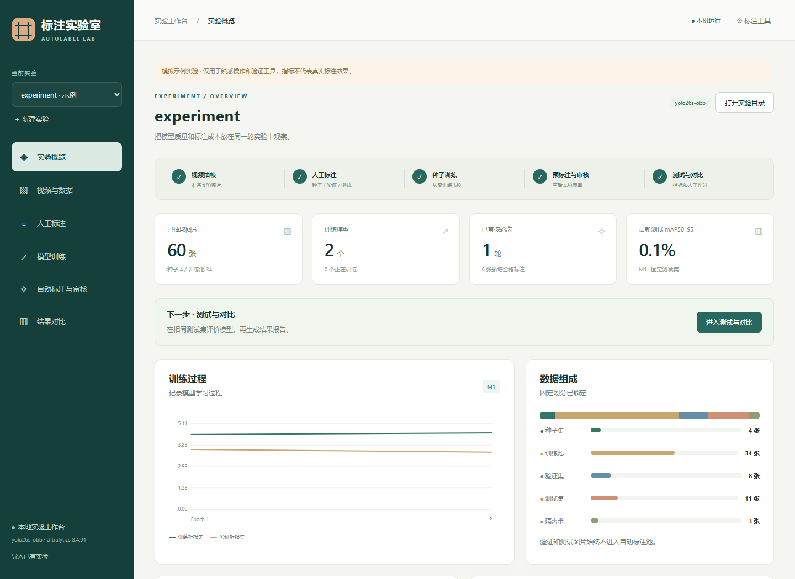
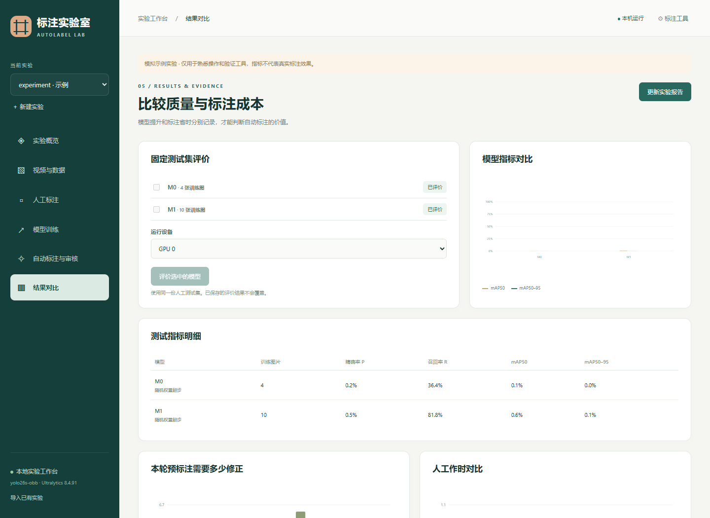

# 自动标注实验工具

这个项目用于验证以下流程：**一段视频按需抽帧 → 十几张人工标注 → 从随机权重训练 M0 → 模型预标注新图片 → X-AnyLabeling 人工修正 → 训练 M1 → 比较标注工时和固定测试集指标**。

这是配合 X-AnyLabeling 使用的本地实验工作台，任务类型为旋转框 OBB。网页提供实验操作和结果可视化；旋转框的绘制与修改在 X-AnyLabeling 中完成。图片、标注、权重、预测和报告均保存在实验目录中，原有命令行入口也可继续使用。

## 快速开始

推荐 Windows 10/11、64 位 Python 3.11 或 3.12。基础工具支持 Python 3.10 及以上；有 NVIDIA GPU 可以加速训练，没有 GPU 也可以选择 CPU 验证流程。安装前确认 PowerShell 中 `python --version` 能显示版本。

从 GitHub 下载：

```powershell
git clone https://github.com/TBeiMu/autolabel-lab.git
cd autolabel-lab
powershell -NoProfile -ExecutionPolicy Bypass -File .\scripts\setup.ps1 -Training
```

没有 Git 时，点击仓库页面的 **Code → Download ZIP**，解压后在目录中打开 PowerShell，运行上面的 `setup.ps1 -Training` 命令。依赖安装到本目录的 `.venv`，首次安装训练依赖需要下载较大的文件。只想查看界面和测试数据流程时可以先不加 `-Training`；开始实际训练前再运行带 `-Training` 的安装命令。

然后下载并安装 [X-AnyLabeling v4.3.0 Windows CPU](https://github.com/CVHub520/X-AnyLabeling/releases/tag/v4.3.0)，选择 `X-AnyLabeling-v4.3.0-Windows-CPU-Setup.exe`。双击本项目的 **`启动实验工作台.bat`**，在右上角「标注工具」选择安装后的 X-AnyLabeling 应用程序，接着按下方「第一次操作」完成实验。训练页面选择 GPU 0 前，先执行以下检查；返回 `False` 时选择 CPU，或按 [PyTorch 官方安装说明](https://pytorch.org/get-started/locally/) 为当前 GPU 安装匹配的 PyTorch：

```powershell
& .\.venv\Scripts\python.exe -c "import torch; print(torch.__version__); print(torch.cuda.is_available())"
```

仓库提供程序、测试和合成数据的界面截图。每个人使用自己的视频和类别新建实验；训练数据、标注、权重、日志和本机环境路径保存在本地。更详细的说明见 [新电脑使用指南](docs/getting-started.md) 和 [在 X-AnyLabeling 加载自定义模型](docs/custom-model.md)。

## 可视化工作台：双击启动

安装环境后，在项目目录双击 **`启动实验工作台.bat`**，浏览器会打开 **http://127.0.0.1:8765**。默认使用项目 `.venv`，也可用 `runtime.local.json` 指定已有训练环境，无需另外安装网页框架。也可在 PowerShell 运行：

```powershell
& .\scripts\start-web.ps1
# 默认端口被其他程序占用时：
& .\scripts\start-web.ps1 -Port 8766
```

工作台预览（合成示例数据）：





网页左侧按实验步骤排列：

| 页面 | 可以做什么 |
|---|---|
| 实验概览 | 查看流程进度、数据组成、模型记录和训练曲线；进入下一步 |
| 视频与数据 | 选择本地视频、预览指定秒数、设置抽帧范围和间隔、固定划分、查看图片大图 |
| 人工标注 | 打开种子/验证/测试标注目录、查看 JSON 已保存数量、导入校验、记录种子标注工时 |
| 模型训练 | 设置 epochs、尺寸、batch、设备和审核轮次，检查数据，从零训练或从父模型继续；查看损失曲线和日志 |
| 自动标注与审核 | 生成新轮次，打开 X-AnyLabeling 修正，逐图并排查看原始预测和审核框，导入审核结果、计时 |
| 结果对比 | 在固定测试集评价多个模型，对比 P/R/mAP、误检和补漏、人工作时，下载 Markdown/CSV/JSON 报告 |

### 已经有 YOLO OBB 图片和标注

点击左侧 **「导入 YOLO 图片」**，选择包含 `data.yaml`、`images/train`、`images/val` 和对应 `labels` 的数据集根目录，填写独立实验名称。默认选择 200 张初始训练、50 张验证、200 张自动标注与审核、50 张固定测试图片。原数据保持不变，工作台复制选中图片，并将已有 TXT 转为 X-AnyLabeling JSON；类别自动读取并保留顺序。原 YAML 中其他机器的 `path` 不参与导入路径解析。

导入使用固定随机种子，从原 val 选择验证图片，其他三组从原 train 无交集抽样；检查图片、四角标注、重复像素和类别覆盖。导入完成后可以直接到「模型训练」检查数据并训练 M0；再到「自动标注与审核」用 M0 预测 200 张训练池图片，逐图审核保存。审核池原有标签只保存在 `references/pool` 作参考，生成的审核目录从模型预测开始。已有标注的导入不会伪造人工审核记录或工时。

同轮次审核完成后训练 M1，训练数据为 200 张初始图片加 200 张审核图片；固定的 50 张验证和 50 张测试始终不加入训练。抽样清单位于 `reports/selection.csv`，导入来源和类别统计位于 `source_import.json`。图片已打乱，相关动作/视频/视角可能跨子集，报告会说明这一评价边界。

命令行也可以在已创建、类别一致的空实验中执行：

```powershell
& .\scripts\lab.ps1 --project experiments/demo import-yolo --source 'D:\YourDataset' --train-count 200 --val-count 50 --pool-count 200 --test-count 50
```

### 第一次操作

1. 点击「新建实验」，填写名称、目录标识和真实目标类别。目录标识用英文、数字或下划线；显示名称支持中文。新实验默认 YOLO26s-OBB，与原项目当前结构一致。
2. 在「视频与数据」选择视频、预览画面并抽帧，然后固定划分。默认种子 15 张、验证 15%、测试 20%，边界隔离 2 秒。短视频可以调小隔离间隔或增加抽帧密度。
3. 在「人工标注」分别打开三个标注目录。在 X-AnyLabeling 中画旋转框，将 JSON 保存到图片旁边，包括无目标图的空标注；回到网页分别点击「导入标注」。
4. 在「模型训练」先点击「检查训练数据」，查看任务日志中的计划；保持名称 M0，再点击「开始训练」。推荐先用较少 epochs 验证流程，正式对比时 M0/M1 使用相同训练设置。
5. 在「自动标注与审核」用 M0 预测新图片，打开审核目录逐张修正。点击图片可并排查看两份框；左侧原始预测始终保留。完成全批审核后勾选确认并导入。
6. 在「模型训练」创建 M1，勾选审核轮次 r1。默认仍从随机权重训练，以比较新增审核数据的帮助；需要持续训练时可选择父模型。
7. 在「结果对比」选择模型进行测试集评价，再点击「更新实验报告」。填写审核工时和纯人工基线后，报告才会计算工时减少比例。

右上角「标注工具」可保存本机 **X-AnyLabeling.exe** 路径。「启动标注工具」会启动程序并打开对应目录，在 X-AnyLabeling 内选择该图片目录。未设置程序时也可以用「打开标注目录」并手动启动你已有的 X-AnyLabeling。

X-AnyLabeling 安装包请从 [官方 v4.3.0 发布页](https://github.com/CVHub520/X-AnyLabeling/releases/tag/v4.3.0) 单独下载，仓库不包含安装包。CPU 版用于人工旋转框标注，也能执行 ONNX 推理；本工作台的 GPU 训练与预标注不受影响。安装后在「标注工具」选择应用程序 `.exe`，不要选择 `Setup.exe`。已有本地安装包可继续使用。

### 任务与结果保存

- 网页每 2.5 秒更新后台状态；训练曲线按完成的 epoch 更新，详细进度在「查看日志」中。
- 同时只执行一个后台操作。训练、抽帧、预测和评价支持「停止」；停止请求在当前批次/图片边界生效，等待任务结束再重试。失败或停止的模型和轮次保留记录，重试用新名称。
- 关闭浏览器不会停止后台服务或训练。重复双击启动文件会打开已有服务。服务日志位于 `.gui/server.log` 和 `.gui/server-error.log`，每项任务的日志位于 `.gui/jobs/<任务ID>/output.log`。
- 网页服务重启会按 PID 和进程创建时间核验并恢复仍运行的工作进程；恢复任务仍可停止，结束结果由独立进程保存。核验中会阻止新任务，避免两项训练竞争 GPU。进程异常结束且未保存结果时才显示「中断」。
- 计时可以跨页面继续，刷新或关闭网页会重置尚未保存的计时。暂停后检查秒数再保存；每次保存属于新工作时段，重复保存会累加。切换实验/阶段后不会混入其他计时。
- 工时提交期间保留计时与填写内容，保存失败可直接重试，只有保存成功才清空。人工标注页的已保存数量和进度条会随后台轮询更新，不需要切换页面。
- 新实验位于 `experiments/<目录标识>`；「导入已有实验」选择包含 `project.json` 的目录即可显示之前的标注和结果。模拟验证实验会明确显示「示例」，其指标不是实际实验结论。
- 人工导入与审核归档后固定；新增操作后需要更新报告。用于比较的测试集始终独立，不参与训练。

网页仅监听本机 `127.0.0.1`，无需账户和联网服务。若在另一台机器使用，先按文末安装环境。

## 命令行使用

在 PowerShell 中进入本项目目录，执行 `scripts/lab.ps1`。默认使用安装步骤创建的 `.venv`；如需复用已有 Python 环境，可按 [新电脑使用指南](docs/getting-started.md) 设置 `ALAB_PYTHON` 或创建本机 `runtime.local.json`。

运行顺序示例见下面。**把 `object_a,object_b` 替换为真实类别，把视频路径替换为你的视频。** 类别顺序在创建实验后固定，X-AnyLabeling 中的名称必须完全一致。

```powershell
& .\scripts\lab.ps1 --project experiments/demo init --classes 'object_a,object_b'
& .\scripts\lab.ps1 --project experiments/demo extract --video 'D:\Videos\sample.mp4' --every 1 --max-frames 150
& .\scripts\lab.ps1 --project experiments/demo split --seed-count 15 --gap-seconds 2
& .\scripts\lab.ps1 --project experiments/demo status
```

指定时间范围或时间点也可以：

```powershell
# 在 10–120 秒间，每 2 秒抽一帧
& .\scripts\lab.ps1 --project experiments/demo extract --video 'D:\Videos\sample.mp4' --start 10 --end 120 --every 2
# 只抽指定秒数；与 --every 互斥
& .\scripts\lab.ps1 --project experiments/demo extract --video 'D:\Videos\sample.mp4' --timestamps '0,2.5,10,18,30'
```

必须在 `split` 前完成所有抽帧。工具记录源视频哈希、帧索引、基于 FPS 的时间点、图片尺寸和图片哈希，跳过完全重复的解码图像。时间点定位适用于恒定帧率视频；可变帧率视频请先转换，不能把 FPS 推算时间当成精确的显示时间戳。

## 人工种子标注和固定评价集

`split` 对每个视频按时间先后划出训练池、验证段、测试段，默认验证比例 15%、测试比例 20%，再从训练池中均匀选出 15 张种子图片。训练/验证与验证/测试边界各留出时间隔离带；带内图片标记为 `gap`，不参与实验。

打开 X-AnyLabeling，分别打开以下图片目录，使用**旋转框**标注并将 JSON 保存到图片旁边：

| 目录 | 用途 |
|---|---|
| `experiments/demo/workspaces/seed` | 第一轮种子训练 |
| `experiments/demo/workspaces/val` | 选取每轮 best.pt 的固定验证集 |
| `experiments/demo/workspaces/test` | M0、M1 共同使用的固定人工测试集 |

每张图片都需要保存对应 JSON，包括无目标图片的空 `shapes`。未生成 JSON 的图片表示“还没标”，不会自动当成负样本。`classes.txt` 提供名称清单，需要在 X-AnyLabeling 中按这些名称设置标签；它不是自动读取配置的承诺。

```powershell
& .\scripts\lab.ps1 --project experiments/demo import-labels --subset seed
& .\scripts\lab.ps1 --project experiments/demo import-labels --subset val
& .\scripts\lab.ps1 --project experiments/demo import-labels --subset test
# seconds 填真实实测工时；重复记录表示不同工作时段累加
& .\scripts\lab.ps1 --project experiments/demo time --stage seed --seconds 1200 --note '实际种子标注工时'
```

也可通过 `--from 'D:\Labels\seed'` 指定 JSON 目录。导入前整批校验名称、尺寸、坐标、四个角点和类别；支持 rotation、四点凸 polygon，以及轴对齐 rectangle。polygon 仅适合本来就是旋转框的四个角点，请不要把任意分割多边形当作 OBB。超边界框、退化框、未知类别和 ignore/difficult 框会拒绝导入。

人工导入后归档固定。后续修正应建立新实验，避免修改评价基准。验证/测试图片始终不能进入自动标注池和训练数据。

数据快照使用前会校验图片和标签文件的完整集合及哈希；额外复制的图片、孤立标签、嵌套目录里的新增文件和图片 `.npy` 缓存均会被拒绝。Ultralytics 生成的 `labels/train.cache`、`val.cache`、`test.cache` 属于可重建缓存，会在使用快照前清理，让训练和评价从已校验的文本标签重建缓存。

## 从零训练 M0

先检查导出的 YOLO OBB 数据和训练计划，再执行训练。两条命令可以用同一个名称；dry-run 不创建模型，也不会加载训练依赖。

```powershell
& .\scripts\lab.ps1 --project experiments/demo train --name M0 --epochs 100 --imgsz 640 --batch 4 --device 0 --dry-run
& .\scripts\lab.ps1 --project experiments/demo train --name M0 --epochs 100 --imgsz 640 --batch 4 --device 0
```

新实验默认使用与原项目当前模型一致的 **YOLO26s-OBB** 结构（`yolo26s-obb.yaml`），从随机权重训练，不接受 `.pt` 作为从零训练入口。输出类别数由本实验的类别清单决定。需要别的 OBB 结构时用 `--model-yaml` 指定 YAML。明确关闭 `pretrained`、`resume` 和 AMP；AMP 检查可能额外加载参考模型，因此此实验关闭它。网络创建之前设置随机种子，默认固定 AdamW、初始学习率、训练 epochs，并关闭早停。

已有实验保留创建时的 `project.json` 配置和模型记录；升级不会将已训练的 YOLO11 模型改成 YOLO26。需要切换的已有实验，请建立新的实验目录，或在每次从零训练时明确指定 `--model-yaml yolo26s-obb.yaml`。同一轮模型对比应使用相同结构。

GPU 使用 `--device 0`，没有 GPU 用 `--device cpu`。第一轮十几张可能产生很差的预测，这是需要记录的实验结果；工具不保证可用精度。

## 自动标注、查看原始效果、人工修正

```powershell
& .\scripts\lab.ps1 --project experiments/demo autolabel --round r1 --model M0 --count 25 --conf 0.25 --device 0
```

从尚未使用的训练池选 25 张。每轮保存：

- `rounds/r1/raw/*.json`：带置信度的原始预测，冻结并校验哈希。
- `rounds/r1/editable/`：图片和可编辑的 X-AnyLabeling JSON。
- `rounds/r1/round.json`：模型、图片清单、阈值、输入尺寸和机器耗时。

在 X-AnyLabeling 中打开 `editable`，先观察这一轮预测，再逐张删除误检、补漏、改类别、调整旋转框。**没有任何预测的图片也必须审核。** 不要编辑 `raw`。预测角点可能越过图片边界，需在人工修正时处理后才能导入。

```powershell
& .\scripts\lab.ps1 --project experiments/demo import-labels --round r1 --reviewed
& .\scripts\lab.ps1 --project experiments/demo time --stage review --round r1 --seconds 900 --note '实际审核及修正工时'
# 单图记录可加 --frame manifest中的图片id；必须覆盖全轮，才比较整轮工时
```

如果审核导入在最终更新轮次状态时中断，重新执行同一条 `import-labels --round r1 --reviewed` 即可恢复。重试校验并使用已归档的人工结果，不重新读取或覆盖编辑目录的标注。已完成导入的轮次重复执行会返回 `already_imported`；人工 seed/val/test 归档仍不允许覆盖。

`--reviewed` 是你对已完成逐张审核的确认，软件不能自动证明人工真的看过每张图。未确认审核的原始预测不能直接加入训练。

## 训练 M1 和固定测试集比较

```powershell
# 默认再次从随机权重训练，以同设置比较种子数据与新增审核数据
& .\scripts\lab.ps1 --project experiments/demo train --name M1 --rounds r1 --epochs 100 --imgsz 640 --batch 4 --device 0
& .\scripts\lab.ps1 --project experiments/demo evaluate --models 'M0,M1' --device 0
& .\scripts\lab.ps1 --project experiments/demo report
```

第二轮继续时可用 M1 预测 `r2`；M2 显式指定 `--rounds r1,r2`，工具不会偷偷加入别的轮次。模型名称、预测轮次、人工标注和测试评价均不能覆盖。

如果你要的是持续训练流程：

```powershell
& .\scripts\lab.ps1 --project experiments/demo train --name M1_continue --rounds r1 --init continue --from-model M0 --epochs 100 --imgsz 640 --batch 4 --device 0
```

这种结果同时受新增数据和额外训练影响，报告会提醒它不是严格的数据增量对照。

`--init continue` 从本实验的父模型 checkpoint 开始，保留网络权重，并记录父权重哈希。这里 `pretrained=True` 的含义是保留已经加载的父权重；默认从零训练仍为 `pretrained=False`。`resume=False` 表示继续训练建立新的优化器和训练周期，不恢复此前的优化器状态。

## 如何读报告

`reports/report.md` 是可读报告，`report.json` 供后续分析，`per_image.csv` 提供逐图修正统计。

1. **自动标注质量**：原始预测对照人工审核结果，按四边形 IoU 贪心匹配，统计几何近似、框调整、类别修改、多余预测、补漏。默认匹配 IoU 0.5，几何近似阈值 0.95，可在 `report` 中修改。这是几何差异统计，不能把“几何近似”解释为标注人未作任何修改。
2. **标注是否节省人工**：记录纯人工基线和审核修正的实测工时。只有同轮图片都有完整的两组工时记录才计算减少比例；不填基线就显示“不能计算”。可以用 `time --stage manual --round r1 --seconds ...` 录入已测纯人工基线。推荐另一位标注人或交叉顺序控制熟练度、记忆偏差，不要根据预测效果猜耗时。
3. **新增训练数据是否有效**：M0/M1 在同一份固定测试集上的 P、R、mAP50、mAP50–95；机器训练和预测耗时单独保存。测试评价阈值固定，不提供用测试集调阈值的流程。

种子标注工时已单独记录；训练准备、调试、审核工具切换等额外人工成本，可按实际情况另记，不把机器训练耗时当作人工作时。

本实验只能回答当前视频和划分下的问题。相同视频内的时间段隔离比随机相邻帧划分更容易控制重复，但不能证明对新视频、新背景或新场景的泛化。审核结果依赖人工补齐所有漏检，建议抽样复核。相同 epochs 下，数据变多也会增加更新次数；模型提升不能直接证明自动标注本身省人工。

## 新机器安装与验证

```powershell
# 基础工具和测试：不安装 PyTorch
& .\scripts\setup.ps1
# 完整训练依赖：较大；GPU 环境需确认安装的 PyTorch 支持本机 CUDA
& .\scripts\setup.ps1 -Training
# 覆盖本机 runtime.local.json 的环境选择
$env:ALAB_PYTHON = 'D:\Path\To\Your\Environment\Scripts\python.exe'
& .\scripts\verify.ps1
& .\.venv\Scripts\python.exe scripts/smoke.py --out _smoke/core
# 在已安装训练依赖的 Python 中执行真实的两轮小训练和评价
& $env:ALAB_PYTHON scripts/smoke.py --out _smoke/ml --training --device 0
# 包含从零训练及继续训练的实际库验证，并逐张量核对父权重确实传入训练器
& $env:ALAB_PYTHON scripts/verify_training.py --out _smoke/training_check --device 0
# 工作台已启动时，验证 HTTP 任务队列的完整链路及实际训练停止
& $env:ALAB_PYTHON scripts/verify_web.py --out _smoke/web_check --training --device 0
```

换机器时删除或修改 `runtime.local.json`，也可以设置 `ALAB_PYTHON`；优先级为环境变量 → 本机配置 → 项目 `.venv`。`setup.ps1` 仅安装到项目 `.venv`，已有本机配置仍需按需切换。新生成的数据集包含绝对路径，移动实验目录后建议新建实验，不要手改已冻结的数据快照。

自动测试覆盖数据隔离、未标注/负样本区别、JSON 转换、归档与快照防修改、原始预测保留、审核确认、工时完整性和网页 API。`smoke.py` 与 `verify_web.py` 使用自动生成的旋转目标视频与几何真值验证流程，**其模型分数不能当作你真实实验的结果**。训练依赖固定为已验证的 Ultralytics 8.4.91。

此前版本执行过的 `--init continue` 模型可能实际从随机权重训练。升级不会重写旧模型记录；这些模型应使用新名称重新训练，再评价，不能据旧记录判定其保留了父权重。

发生进程异常退出时可能留下 `.operation.lock`。确认没有训练或导入仍在运行后，再删除该锁。失败的模型/轮次保留日志和状态；重新运行请使用新名称。

## 依据

- [Ultralytics OBB 格式与训练接口](https://docs.ultralytics.com/tasks/obb/)
- [Ultralytics 从 YAML 创建并训练模型](https://docs.ultralytics.com/modes/train/)
- [X-AnyLabeling 旋转框 JSON 对应实现](https://github.com/CVHub520/X-AnyLabeling/blob/main/anylabeling/services/auto_labeling/__base__/yolo.py)
- [X-AnyLabeling JSON 读写实现](https://github.com/CVHub520/X-AnyLabeling/blob/main/anylabeling/views/labeling/label_file.py)

兼容验证环境的版本记录随模型写入 `model.json`，无需依赖文档中随时间变化的默认模型。
